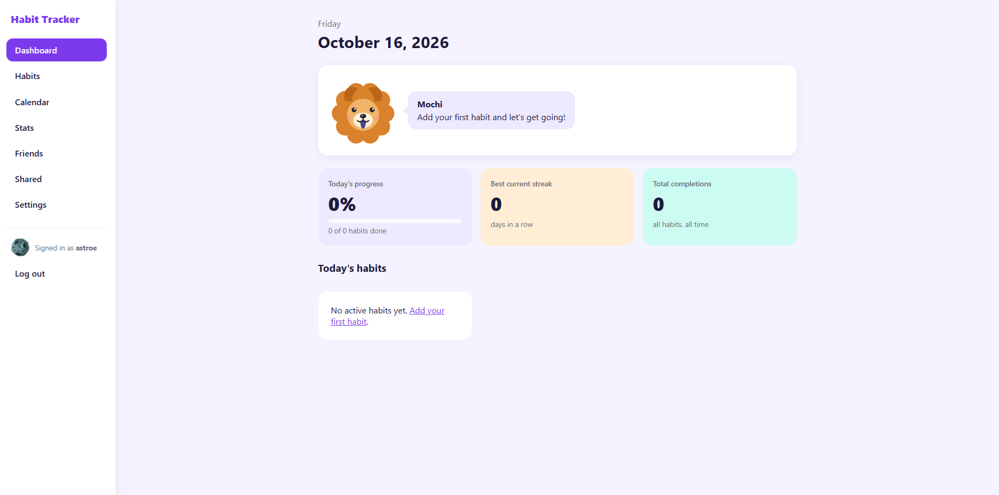
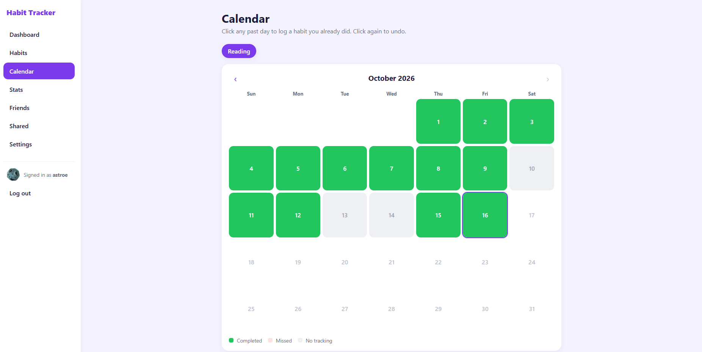
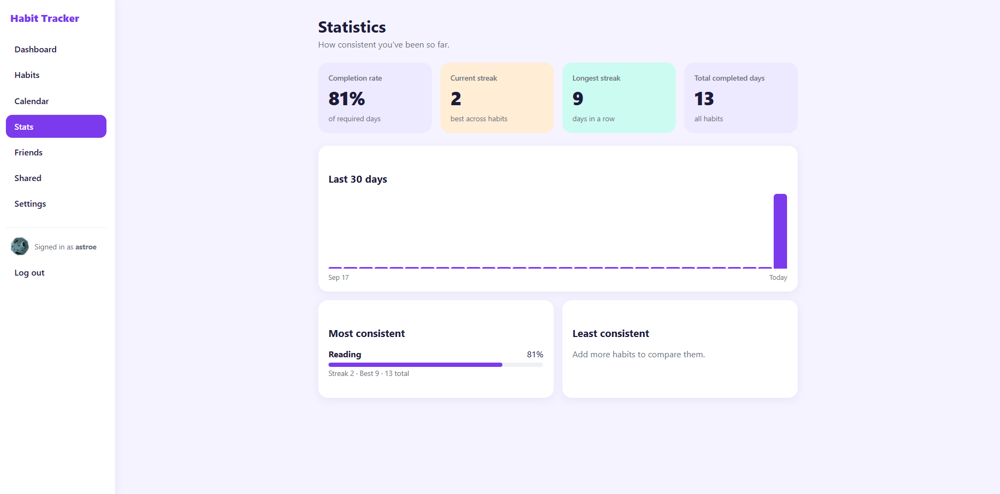
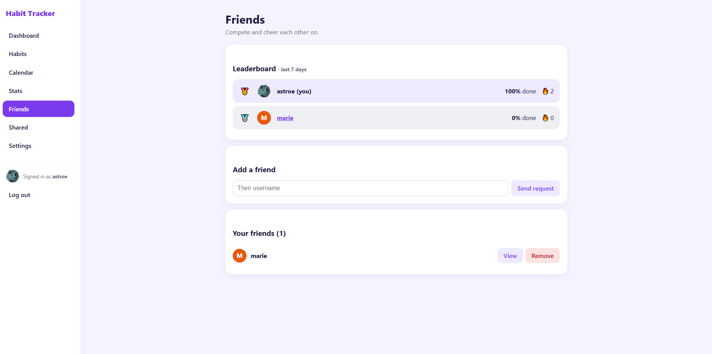
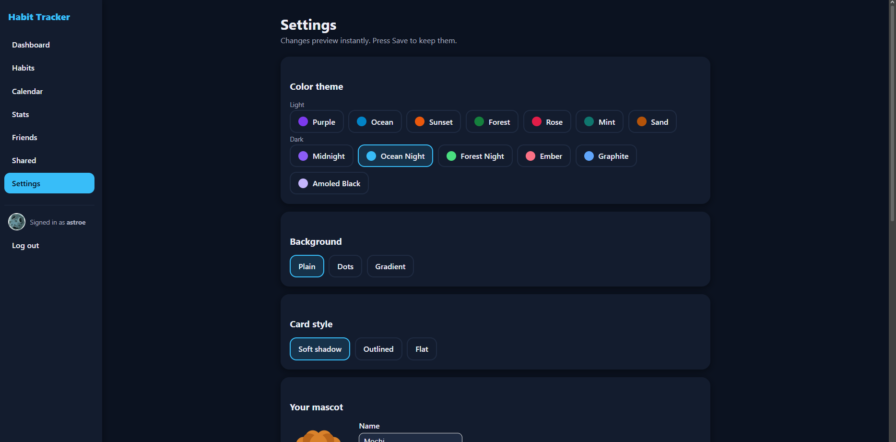
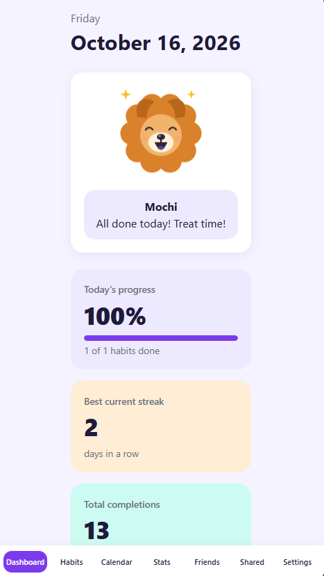

# Jakebit

A web app for building habits together. Track daily habits, watch your streaks grow, compete with friends on a leaderboard, and share habits with a partner or group, all with a chow chow mascot cheering you on.

## Screenshots

| Dashboard | Calendar |
|---|---|
|  |  |

| Statistics | Friends |
|---|---|
|  |  |

| Dark theme | Mobile |
|---|---|
|  |  |

## Features

- **Accounts:** register, log in and out, with hashed passwords and CSRF protection
- **Habit management:** add, edit, pause, reactivate and delete habits (name, category, frequency)
- **Daily tracking:** one-tap check-off with undo, plus filters for All / To do / Done
- **Streaks:** current streak, longest streak and total completions, with weekday-aware logic
- **Calendar:** monthly view per habit; click any past day to log a habit you already did
- **Statistics:** completion rate, 30-day chart, most and least consistent habits
- **Friends:** send and accept requests, plus a weekly leaderboard
- **Privacy controls:** choose whether friends can see your scores and your habit names
- **Shared habits:** pairs and groups, each person checks off their own part, with a group streak when everyone does it
- **Profile pictures:** upload your own photo (validated, cropped and re-encoded on the server)
- **Personalization:** 13 color themes (7 light, 6 dark), background and card styles, and a mascot with your choice of name and fur color
- **Responsive:** works on phones, tablets, laptops and desktops

## Tech stack

- Python 3 and Flask
- SQLite
- Jinja2 templates, HTML5, CSS3 and a little JavaScript
- Flask-WTF (CSRF protection), Werkzeug (password hashing), Pillow (image processing), python-dotenv
- pytest for automated tests

## Getting started

### 1. Clone and set up

```bash
git clone https://github.com/YOUR-USERNAME/habit-tracker.git
cd habit-tracker
python -m venv venv
```

Activate the virtual environment:

- Windows (PowerShell): `venv\Scripts\Activate.ps1`
- Mac/Linux: `source venv/bin/activate`

Install the dependencies:

```bash
pip install -r requirements.txt
```

### 2. Configure your secret key

Copy `.env.example` to `.env` (`copy .env.example .env` on Windows, `cp .env.example .env` on Mac/Linux). Generate a random key:

```bash
python -c "import secrets; print(secrets.token_hex(32))"
```

Paste it into `.env` as the value of `SECRET_KEY`.

### 3. Create the database

```bash
flask --app app init-db
```

Warning: this command deletes and recreates all tables, so only run it on a fresh install.

### 4. Run it locally

```bash
python app.py
```

Open http://127.0.0.1:5000 and create an account.

To try it on a phone or tablet on the same Wi-Fi, run `flask --app app run --host 0.0.0.0` and open `http://YOUR-COMPUTER-IP:5000` on the device. Don't use debug mode this way.

## Running the tests

```bash
pytest
```

Each test uses its own temporary database, so your real data is never touched.

## Project structure

```
habit-tracker/
├── app.py            # app factory: configuration and blueprint registration
├── db.py             # database connection and the init-db command
├── schema.sql        # table definitions
├── auth.py           # register, login, logout, login_required
├── habits.py         # add, edit, pause and delete habits
├── tracking.py       # dashboard, daily check-off, streak logic, calendar
├── stats.py          # statistics page
├── friends.py        # friend requests, leaderboard, friend profiles
├── scores.py         # weekly score calculations
├── shared.py         # shared habits for pairs and groups
├── settings.py       # themes, mascot and privacy settings
├── avatars.py        # profile picture upload and serving
├── requirements.txt
├── pytest.ini
├── .env.example
├── templates/        # Jinja2 pages (base, dashboard, habits, calendar, ...)
├── static/
│   ├── css/style.css
│   └── js/script.js
├── tests/
│   ├── conftest.py
│   └── test_app.py
└── docs/screenshots/
```

Created at runtime and not committed: `database/database.db`, `uploads/avatars/`, `.env`.

## Security notes

- Passwords are salted and hashed with Werkzeug. Plain-text passwords are never stored.
- All SQL uses parameterized queries.
- Forms are protected against CSRF, and sessions use HttpOnly, SameSite cookies.
- Every route checks that the logged-in user owns or is allowed to see the data, which is covered by tests.
- Profile pictures are decoded, validated, cropped and re-saved as new JPEGs, stored in the database, and only served through a permission-checked route.
- Secrets come from environment variables and are never committed.

## Deploying on Vercel

The app runs as a Vercel Python function with a PostgreSQL (Neon) database. Locally it still uses SQLite.

1. Import the GitHub repo in Vercel and connect a Neon database (Storage tab). That adds `DATABASE_URL`.
2. Add the environment variables `SECRET_KEY` (a long random string) and `PRODUCTION=1`.
3. Create the tables once from your computer: set `DATABASE_URL` to the Neon connection string, then run `flask --app app init-db`.
4. Redeploy. Static files are served from `public/static`.

Database changes: edit both `schema.sql` and `schema_pg.sql`, add a numbered file to `migrations/` (SQLite) and `migrations_pg/` (Postgres), then run `flask --app app migrate`.

## Future improvements

- Real weekly-habit streak logic (weekly habits currently count like daily ones)
- Notifications for friend requests and invitations
- Let a group creator remove members and cancel invitations
- Password reset and email verification
- Rate limiting on login and friend requests
