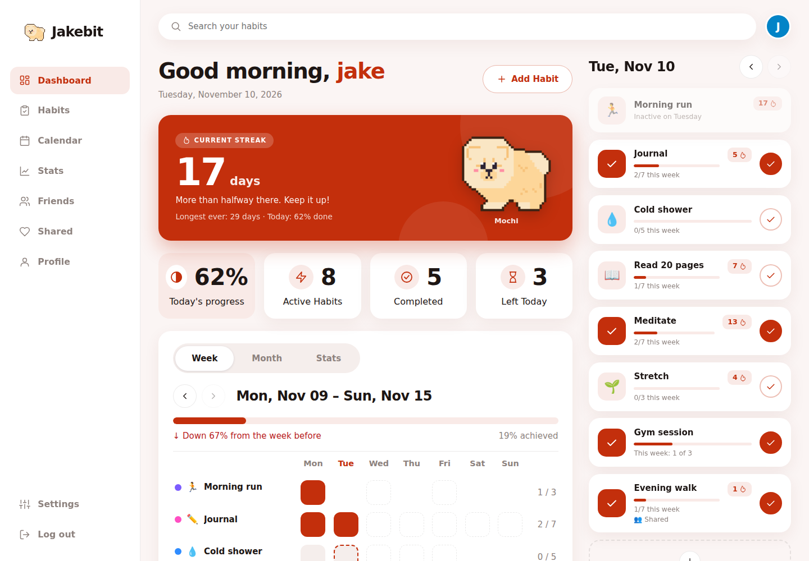
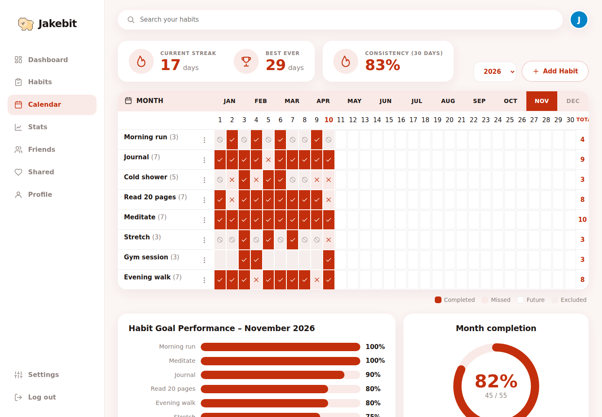
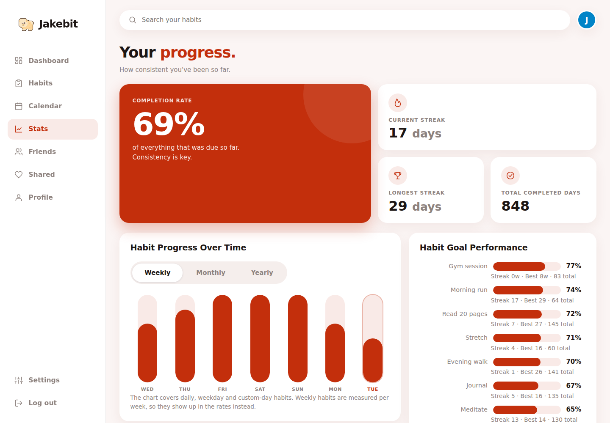
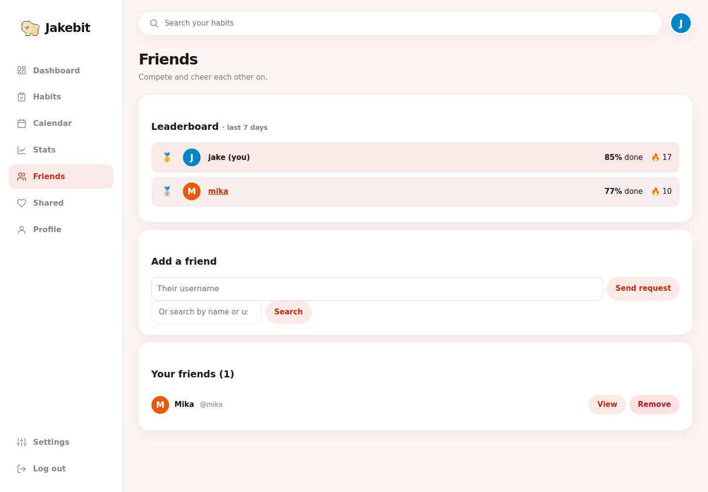
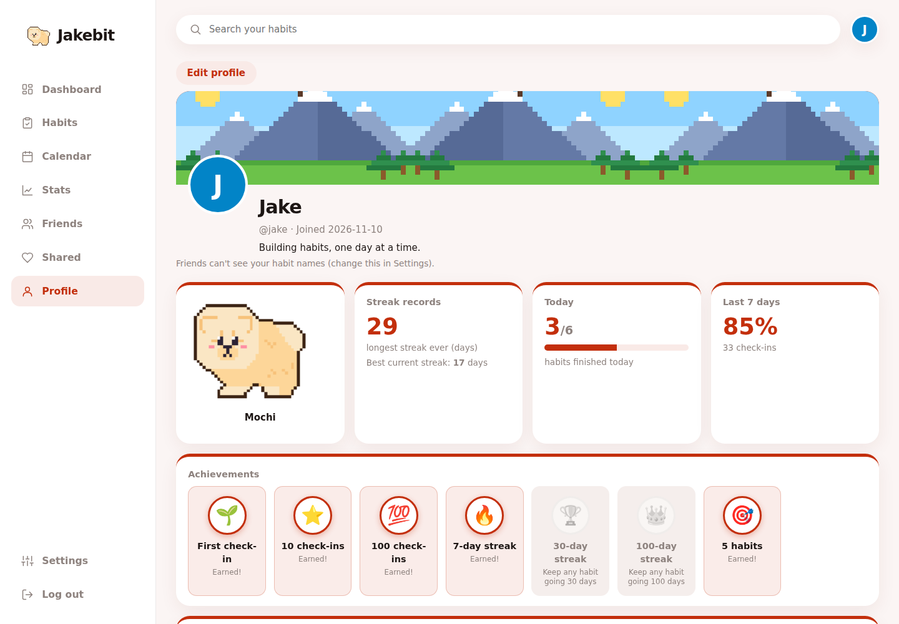
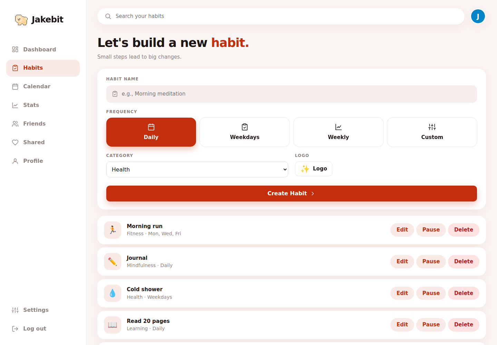
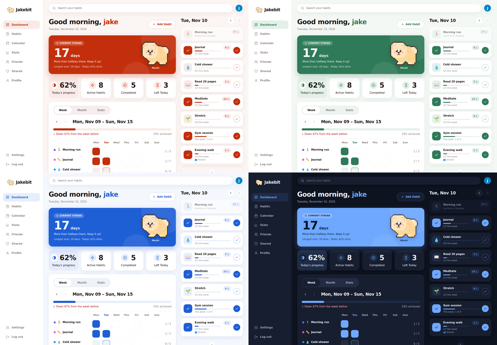
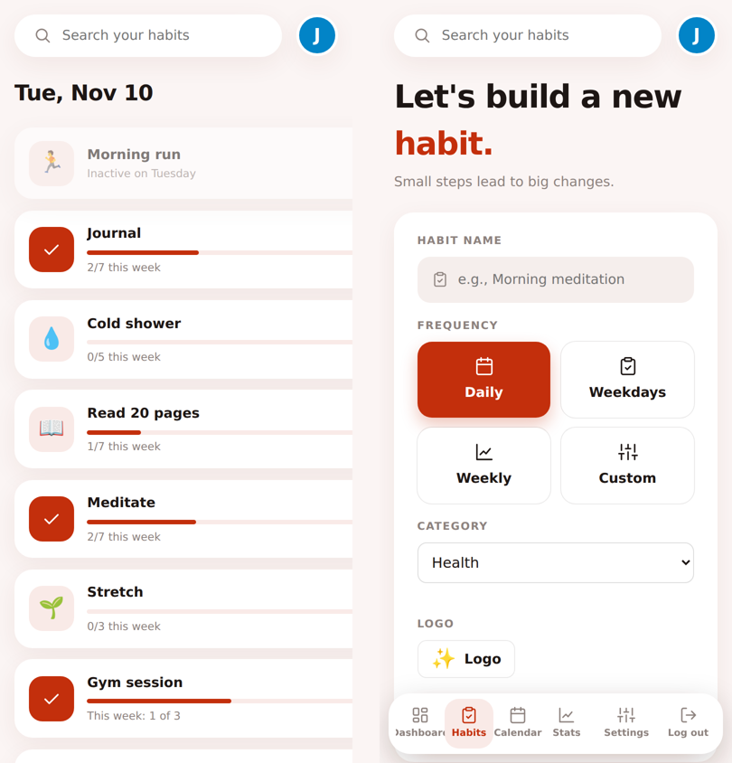

# Jakebit

A habit tracker for building habits together. Track daily, weekly and custom habits, grow your streaks, compete with friends, share habits with a group, and customize your own profile page, all with a pixel-art chow chow cheering you on. It installs as an app on your phone or computer.

## Screenshots

| Dashboard | Month tracker |
|---|---|
|  |  |

| Statistics | Friends |
|---|---|
|  |  |

| Profile | New habit |
|---|---|
|  |  |

| Themes | On a phone |
|---|---|
|  |  |

## Features

### Habits and tracking
- **Flexible schedules:** daily, weekdays only, weekly goals (1 to 7 times a week) or custom days (pick the weekdays)
- **Emoji logos:** pick a logo for each habit from 50 emojis, or let the category choose one
- **Dashboard:** a streak card with your mascot, today's progress, a week grid you can click to log or undo any day, and a side panel with one soft card per habit (progress bar, streak badge and a round check button). Step through past days to log what you already did
- **Month tracker:** habits as rows, days as columns. Completed, missed, future and excluded days at a glance, with month tabs, a year picker and goal-performance charts
- **Streaks:** current and longest streaks that understand schedules (days off never break a streak, and weekly habits count weeks)
- **Statistics:** completion rate, streak records and capsule trend bars (weekly, monthly or yearly) plus a performance ranking for every habit
- **Search:** the top search box filters your habits on any page

### Friends and groups
- **Friends:** send and accept requests, find people by name or username (results show picture, display name and bio so look-alike usernames are easy to tell apart), and compete on a weekly leaderboard
- **Privacy controls:** choose whether friends can see your scores and your habit names, and whether you appear in friend search
- **Group habits:** up to 10 people, with every schedule type. Everyone checks off their own part and the group streak counts only when everyone did it (for weekly habits, a week counts when every member reached the goal). The creator edits the habit for everyone, and each member picks their own logo

### Profiles
- **Customizable profile page:** display name, bio, profile picture, a pixel-art banner (mountains, flower park or moonlit forest) and an accent color that follows your theme or a fixed color
- **Widgets you arrange:** your mascot, streak records, today, last 7 days, all-time totals, achievements and your habit list. Switch them on or off and reorder them
- **Achievements:** badges with symbols for check-ins, streaks and number of habits, locked until you earn them

### A pixel world
- **Mascot:** a chow chow with your choice of name and fur color (golden, cream, red, brown, black or blue) that reacts to your day
- **Nature scenes:** a mountain whose flag climbs as your streak grows, a park where flowers bloom as you finish habits, and a forest that grows a tree for every 8 check-ins

### Look and feel
- **8 calm themes:** Terracotta, Ocean, Sage, Sand and Mono (light), plus Graphite, Midnight and Amoled Black (dark)
- **Personalization:** background styles (plain, dots, gradient), card styles (soft shadow, outlined, flat) with a live preview in Settings
- **Responsive:** a sidebar on computers and a floating bottom bar on phones

### An installable app
- **Installable (PWA):** add it to your home screen or desktop and it opens full-screen with its own icon, shortcuts and a friendly offline page
- **Private by design:** pages with personal data are never stored on the device

### Accounts and security
- **Accounts:** register, log in and out, with hashed passwords and CSRF protection
- **Password reset without email:** a one-time recovery code you save in Settings
- **Rate limiting:** failed logins, sign-ups, friend requests, searches and reset attempts are limited
- **Profile pictures:** uploads are validated, cropped and re-encoded on the server

## Tech stack

- **Backend:** Python 3 and Flask
- **Database:** SQLite for local development and tests, PostgreSQL (psycopg) in production. The same SQL runs on both
- **Frontend:** Jinja2 templates, HTML5, CSS3 and a little vanilla JavaScript (no frameworks)
- **Libraries:** Flask-WTF (CSRF), Werkzeug (password hashing), Pillow (images), python-dotenv
- **Testing:** pytest (about 140 tests)
- **Hosting:** Vercel with a Neon PostgreSQL database

## Getting started

### 1. Clone and set up

```bash
git clone https://github.com/YOUR-USERNAME/habit-tracker.git
cd habit-tracker
python -m venv venv
```

Activate the virtual environment:

- Windows (PowerShell): `venv\Scripts\Activate.ps1`
- Mac/Linux: `source venv/bin/activate`

Install the dependencies:

```bash
pip install -r requirements.txt
```

### 2. Configure your secret key

Copy `.env.example` to `.env` (`copy .env.example .env` on Windows, `cp .env.example .env` on Mac/Linux). Generate a random key:

```bash
python -c "import secrets; print(secrets.token_hex(32))"
```

Paste it into `.env` as the value of `SECRET_KEY`. Leave `DATABASE_URL` out to use the local SQLite file.

### 3. Create the database

```bash
flask --app app init-db
```

Warning: this deletes and recreates all tables, so only run it on a fresh install.

### 4. Run it locally

```bash
flask --app app run
```

Open http://127.0.0.1:5000 and create an account.

To try it on a phone or tablet on the same Wi-Fi, run `flask --app app run --host 0.0.0.0` and open `http://YOUR-COMPUTER-IP:5000` on the device. Don't use debug mode this way.

### Updating an existing install

After pulling new code, bring your database up to date without losing data:

```bash
flask --app app migrate
```

Never run `init-db` on a database you want to keep.

## Running the tests

```bash
pytest
```

Every test uses its own temporary SQLite database, and tests ignore `DATABASE_URL`, so your real data is never touched.

## Installing it as an app

Open the live site in **Chrome or Edge** and click **Install app** in the sidebar (or **Settings → Install the app**). On **iPhone/iPad**, open it in Safari, tap Share, then **Add to Home Screen**. On a Mac with Safari 17 or newer, use **File → Add to Dock**. Browsers without web-app support, such as Firefox and Opera, can't install it, but the site works normally in them.

## Deploying on Vercel

The app runs as a Vercel Python function with a PostgreSQL (Neon) database.

1. Import the GitHub repo in Vercel and connect a Neon database (Storage tab). That adds `DATABASE_URL`.
2. Add the environment variables `SECRET_KEY` (a long random string) and `PRODUCTION=1`.
3. In **Settings → Functions**, choose the function region closest to your database (for example Singapore), so pages load quickly.
4. Create the tables once from your computer: set `DATABASE_URL` to the Neon connection string (in quotes), then run `flask --app app init-db`.
5. Deploy. Static files are served from `public/static`.

### Changing the database

1. Edit **both** `schema.sql` (SQLite) and `schema_pg.sql` (PostgreSQL).
2. Add a numbered file to `migrations/` and to `migrations_pg/`. The PostgreSQL migrations start at 006 because that database was created straight from `schema_pg.sql`.
3. Run `flask --app app migrate` locally, and again against the production database (with `DATABASE_URL` set) before you push the matching code.

## Project structure

```
habit-tracker/
├── app.py             # app factory, configuration, blueprint registration
├── db.py              # SQLite/PostgreSQL connection, init-db and migrate commands
├── schema.sql         # SQLite tables
├── schema_pg.sql      # PostgreSQL tables (keep in step with schema.sql)
├── migrations/        # numbered SQLite migrations
├── migrations_pg/     # numbered PostgreSQL migrations
├── auth.py            # register, login, logout, login_required
├── ratelimit.py       # database-backed rate limiting
├── recovery.py        # recovery codes and password reset
├── habits.py          # add, edit, pause and delete habits, emoji logos
├── tracking.py        # dashboard, check-off, streak logic, month tracker
├── insights.py        # shared numbers: week grid, trends, rates
├── stats.py           # statistics page
├── friends.py         # requests, search, leaderboard, friend profiles
├── scores.py          # weekly score calculations
├── shared.py          # group habits and group streaks
├── profiles.py        # customizable profiles, widgets, achievements
├── settings.py        # themes, mascot and privacy settings
├── avatars.py         # profile picture upload and serving
├── pixelart.py        # the pixel chow chow
├── pixelscenes.py     # pixel nature scenes
├── pwa.py             # manifest, service worker route, offline page
├── tools/make_icons.py# draws the app icons
├── templates/         # Jinja2 pages and small reusable pieces
├── public/static/     # css, js (including the service worker), icons
├── tests/             # conftest.py and test_app.py
└── docs/screenshots/
```

Created at runtime and not committed: `database/database.db` and `.env`.

## Security notes

- Passwords are salted and hashed with Werkzeug, and plain-text passwords are never stored.
- All SQL uses parameterized queries, and search terms are escaped.
- Forms are protected against CSRF, and sessions use HttpOnly, SameSite cookies (Secure in production).
- Every route checks that the logged-in user owns or may see the data. Strangers get a 404, and this is covered by tests.
- Logins, sign-ups, friend requests, searches and password resets are rate limited.
- Password resets use one-time recovery codes that are stored hashed and shown only once.
- Profile pictures are decoded, validated, cropped and re-saved as new JPEGs, stored in the database and served only through a permission-checked route.
- Habit logos must come from a fixed list, so nothing else can be stored.
- The installed app never keeps pages with personal data on the device.
- Secrets come from environment variables and are never committed.

## Ideas for the future

- Reminders and push notifications
- Goals, history and tips pages
- Sign out other devices after a password reset, and an admin path for lost recovery codes
- Unlockable mascot outfits earned with streaks
- More pixel scenes and profile banners
- Email verification and optional email reset
